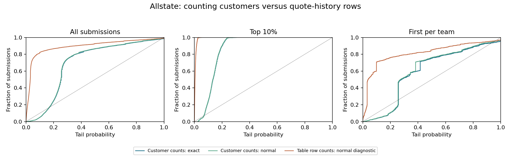

# Allstate scoring-unit verification

16 November 2026. This note updates the Allstate section of the stage 1 audit. It concerns an original 2019-study competition only.

## Verified from the downloaded file

The researcher downloaded `test_v2.csv` from the Allstate Purchase Prediction Challenge and placed it in the project's `data/reference/` folder.

| Quantity | Count |
|---|---:|
| Quote-history rows | 198,856 |
| Distinct `customer_ID` values | 55,716 |
| Missing `customer_ID` values | 0 |
| Total of the paper's public/private sizes, 59,657 + 139,199 | 198,856 |

SHA-256: `9afb8de68728764905a5f1827256a4e423baba0508d7df9d55ea5ca3e73eb458`.

The competition asks for one prediction per customer, with the seven insurance-option values jointly determining correctness. A customer may have multiple quote-history rows. The table's total equals the number of rows exactly, rather than the number of predictions. This is strong evidence of a scoring-unit error in the published size table. It does not establish which values the original implementation used.

## Reconstructing the split counts

Observed public and private scores include 8991/16714 and 20777/39002 in reduced form. Under equally weighted customer accuracy, accurately represented scores, and disjoint public/private customer subsets, these reduced denominators constrain the sizes to positive multiples of 16,714 and 39,002. Their sum already exhausts the 55,716 customers. Therefore the pair is uniquely constrained under those assumptions. All 24,523 retained pre-deadline Allstate score pairs satisfy these counts to numerical tolerance.

The overall customer count is independently verified from the file. Split membership was not directly read from a released solution file; the split counts are reconstructed algebraically.

## Effect on the statistical diagnostic

| Subset | Customer counts, exact inclusive test | Customer counts, normal approximation | Published row counts, normal approximation |
|---|---:|---:|---:|
| All submissions | 1.285% | 1.313% | 74.620% |
| Top 10% by public score | 3.832% | 3.873% | 99.918% |
| First per team, date/ID proxy | 1.783% | 1.783% | 52.484% |

Entries are the fraction of submissions with a tail probability at most 0.05. The normal approximation uses pooled accuracy and variance `p(1-p)(1/n_public + 1/n_private)`. The row-count calculation is a deliberately misspecified sensitivity diagnostic, **not** a claim to have recovered the authors' Stirling-based code. The customer-count exact calculation uses the validated hypergeometric routine.

The table-size choice alone can produce a large concentration of small tail probabilities. The visible original Allstate p-value plot resembles the row-count scenario qualitatively, but visual resemblance is insufficient to establish the implementation or cause of the published plot. We should request original code/configuration and the historical snapshot before making an implementation-error claim.

The measured mean public/private gap does not change when the scoring denominator changes. Thus this finding affects uncertainty interpretation, not the raw gap or proof of adaptation. Nor does it by itself overturn the paper's conclusion that large adaptive-overfitting effects were uncommon.

## OpenReview lead resolved

The researcher inspected HJlr9NBgUr and found mixed metadata: the Kaggle paper title/PDF alongside Meta-MDP authors, abstract and repository. They downloaded the linked report rkedITqfpB as `21__replication_a_meta_mdp_approa.pdf`.

The downloaded report's first page was inspected. It is titled **[Replication] A Meta-MDP Approach to Exploration for Lifelong Reinforcement Learning**, by David Cabatingan, Kendrick Cole, Natalie Delworth and Petar Peshev (Brown University). It concerns reinforcement learning, not Kaggle leaderboard overfitting. The Meta-MDP repository and this report must not be cited as source code or a prior replication of the Kaggle study.

## Next necessary source check

The remaining implementation-level replication dependency is the original analysis code, configuration and data-snapshot date. The public search and misleading OpenReview trail did not supply them. A targeted request to an original author is now the efficient next step. No message has been sent.

The project remains viable as a careful replication and extension with measurement validation. The boundary is that neither a confirmed size-table discrepancy nor this sensitivity analysis alone establishes a complete, publication-ready contribution.
